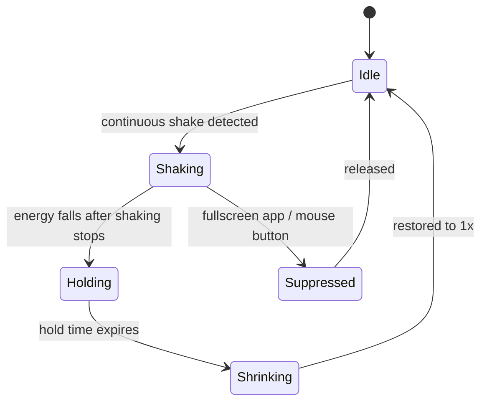
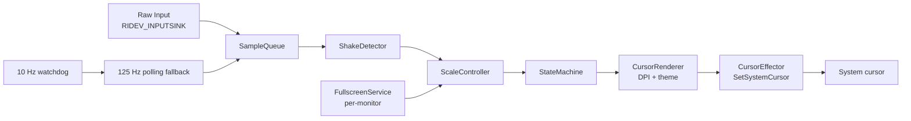

# CursorBeacon

[简体中文](README.zh-CN.md)

**CursorBeacon** is a lightweight Windows utility that makes the mouse pointer grow when you shake the mouse — then shrink back automatically. It is built for 4K/8K displays and multi-monitor setups where the pointer is easy to lose, and it stays out of the way in fullscreen apps.


> **Status: 0.1.0 preview.** The core service is working and tested. Tray icon, settings UI and auto-start are planned for the next milestone.

---

## Why CursorBeacon?

Large, high-DPI or multi-monitor desktops make the pointer easy to lose. CursorBeacon lets you shake the mouse to temporarily enlarge the **real system cursor** — no overlay window, no mouse hook, no admin rights. When you stop shaking, the cursor returns to normal size.

It is inspired by macOS's *Shake mouse pointer to locate*, with extra work for Windows-specific problems:

- per-monitor DPI (100%–300%)
- per-monitor fullscreen suppression
- Raw Input sampling with a low-power polling fallback
- crash-safe cursor restore

## Behavior



A deliberate shake is recognized by all of the following (defaults):

- 3+ direction reversals within 600 ms
- peak speed ≥ 800 DIP/s
- shake amplitude ≥ 80 DIP
- path length ≥ 250 DIP
- net displacement / path ≤ 0.50
- net displacement / amplitude ≤ 0.35
- energy sustained for 250 ms before enlargement starts

The last three filters are what keep ordinary navigation (moving across the screen, zig-zagging between windows) from being mistaken for a shake: a shake returns near its starting point, while normal navigation keeps making progress. After restoring, there is a 600 ms cooldown to avoid chatter.

## Features

- **Progressive enlargement** — 1.25x, 1.5x, 2x, 3x, 4x… up to 8x (default max 4x)
- **Automatic shrink** — hold for 800 ms after shaking stops, then ease back to 1x
- **Click to restore** — clicking any mouse button shrinks immediately
- **Per-monitor DPI** — uses the cursor's monitor DPI, not the primary monitor's
- **Per-monitor fullscreen suppression** — a fullscreen app on monitor A does not disable the feature on monitor B
- **Real system cursor** — replaces the cursor via `SetSystemCursor`, preserving shape and hotspot
- **Low overhead** — Raw Input events; a 10 Hz watchdog; 125 Hz polling only when needed
- **Crash-safe** — dirty flag + `--restore` + exit/crash handlers
- **No admin, no network, no telemetry** — reads the current cursor theme from `HKCU`, writes only its own app-data folder

## Requirements

- Windows 10 1809+ or Windows 11, x64
- No .NET/Visual C++ runtime required (static build)
- Standard user; **administrator is not required**

## Install

1. Download `CursorBeacon-0.1.0-win64.zip` from the [latest release](../../releases/latest).
2. Extract it anywhere, e.g. `%LOCALAPPDATA%\Programs\CursorBeacon`.
3. Run:

```powershell
.\start-service.ps1
```

4. Shake the mouse back and forth. The pointer grows; stop and it shrinks on its own.

Useful scripts:

```powershell
.\status.ps1          # show process, memory and last log lines
.\stop-service.ps1    # gracefully stop and restore the cursor
```

> **SmartScreen / antivirus:** the binary is unsigned. If Windows shows a warning, verify the SHA-256 in `CHECKSUMS.txt` and build from source if you prefer.

Portable/manual start (no scripts):

```powershell
.\CursorBeacon.exe --run
```

## Usage

### The gesture

Shake the mouse quickly back and forth, roughly 3–5 Hz, with at least ~300 px of travel. The cursor grows in steps. When you stop moving, it holds for 800 ms and then shrinks.

Ordinary mouse movement — crossing the screen, moving between windows, zig-zagging to a menu — is filtered out. Dragging/selection is suppressed while a mouse button is held.

### Click to dismiss

Pressing any mouse button restores the cursor immediately. This is useful if the enlarged cursor is in the way.

### Fullscreen apps

Fullscreen apps are detected per monitor from the foreground window geometry and Windows' fullscreen state. If monitor A is running a fullscreen game/video, shaking on monitor A does nothing; shaking on monitor B still works. Moving the enlarged cursor into monitor A restores it within ~100 ms.

### Multi-monitor and high DPI

The enlarged cursor is generated from the current monitor's cursor size (`GetDpiForMonitor` + `GetSystemMetricsForDpi`) and the user's accessibility cursor size. 4x on a 144 DPI display is 192 px; 4x on a 100% display is 128 px.

### Command-line reference

```text
CursorBeacon.exe --run [--duration N] [--verbose]
CursorBeacon.exe --stats [seconds]
CursorBeacon.exe --test-scale [N]
CursorBeacon.exe --dump-monitors
CursorBeacon.exe --dump-cursors
CursorBeacon.exe --restore
CursorBeacon.exe --stop
CursorBeacon.exe --self-test
CursorBeacon.exe --version
```

| Option | Description |
|---|---|
| `--run` | Run the controller (console service). `--duration N` exits after N seconds (development). |
| `--stats [s]` | Sample and print statistics without changing the cursor. Default 5 s. |
| `--test-scale [N]` | Apply scale N for 2 seconds, then restore. Useful for checking permissions/theme. |
| `--dump-monitors` | Print monitor rects, work areas, DPI and fullscreen decision. |
| `--dump-cursors` | Print the user's cursor theme paths and base sizes. |
| `--restore` | Restore the system cursor scheme immediately. |
| `--stop` | Ask a running instance to exit and restore. |
| `--self-test` | Run the built-in logic checks without a separate test binary. |
| `--config PATH` | Use an alternate config file. |
| `--scale N` | Override max scale (1–8). |
| `--sensitivity N` | Override sensitivity (1–10). |
| `--hold-ms N` | Override hold time (0–5000 ms). |
| `--verbose` | Debug logging. |

## Configuration

Path: `%APPDATA%\CursorBeacon\config.ini`

```ini
enabled=true
max_scale=4
sensitivity=5
hold_ms=800
grow_tau_ms=60
shrink_tau_ms=180
update_hz=30
sampling_mode=auto
cursor_set=all
pause_on_fullscreen=true
pause_on_click=true
```

| Key | Default | Meaning |
|---|---:|---|
| `max_scale` | `4` | Maximum enlargement (1–8) |
| `sensitivity` | `5` | 1–10. Default needs 3 reversals; 8–10 needs 2 (more sensitive); 1–2 needs 4 (more conservative). |
| `hold_ms` | `800` | Time to stay enlarged after shaking stops |
| `grow_tau_ms` | `60` | Growth easing time constant |
| `shrink_tau_ms` | `180` | Shrink easing time constant |
| `update_hz` | `30` | Maximum cursor frame update rate |
| `sampling_mode` | `auto` | Reserved; auto selects Raw Input with polling fallback |
| `cursor_set` | `all` | Cursor shapes to enlarge; `all` covers resize/split-screen cursors too |
| `pause_on_fullscreen` | `true` | Disable on fullscreen monitors |
| `pause_on_click` | `true` | Restore when a mouse button is pressed |

Changes are read when the service starts. Restart with `stop-service.ps1` + `start-service.ps1`.

### Tuning tips

- **Too sensitive** (triggers during normal work): set `sensitivity=1` or `2`, restart.
- **Hard to trigger**: set `sensitivity=8`–`10`, use a deliberate 3–5 Hz shake with 300+ px travel.
- **Cursor too large/small**: change `max_scale` between 2 and 8.
- **Do not enlarge in a specific app**: keep `pause_on_fullscreen=true`; fullscreen apps are already excluded.

## Logs

- `%LOCALAPPDATA%\CursorBeacon\service.err.log`
- `%LOCALAPPDATA%\CursorBeacon\service.out.log`

`start-service.ps1` clears the two log files before starting. Scale changes and restores are logged with millisecond timestamps; `--run --verbose` also prints detector statistics every 2 seconds.

## How it works



- **Sampling:** Raw Input is the primary source. A 10 Hz watchdog detects movement without raw events (precision touchpads, RDP) and temporarily switches to 125 Hz polling. Only one source produces samples at a time.
- **Detection:** direction reversals, speed, amplitude, path length, and two net-displacement filters; then 250 ms activation and 600 ms cooldown.
- **Scaling:** energy drives a target scale; a smoothed controller applies quantized steps at up to 30 Hz.
- **DPI:** `GetDpiForMonitor` + `GetSystemMetricsForDpi`; the cursor is re-rendered when crossing monitors while enlarged.
- **Cursor replacement:** the user's current `.cur` theme is loaded at the target size with `LoadImageW`/`CopyImage`; `SetSystemCursor` swaps the system cursor. No overlay window.
- **Restore:** `SystemParametersInfo(SPI_SETCURSORS)` reloads the user's scheme. A dirty flag lets the next launch recover from a crash.

## Performance

Measured on a 3-monitor setup (all 144 DPI; 2880×1800 + 2560×1440 ×2):

| Metric | Result |
|---|---|
| Release binary | ~940 KB, no runtime DLLs |
| Idle working set | ~10.8 MB |
| Idle CPU | ~0.05% of a 4-core machine |
| 4x cursor | 192 px at 144 DPI |
| Tests | 26 doctest cases + 13 built-in self-test checks |

## Build from source

Local development uses a portable LLVM-MinGW toolchain. CMake also supports MSVC.

```bash
source tools/env.sh
cmake -S . -B build -G Ninja \
  -DCMAKE_CXX_COMPILER="$CXX" \
  -DCMAKE_RC_COMPILER="$(cygpath -m "$LLVM_MINGW")/bin/windres.exe" \
  -DCMAKE_BUILD_TYPE=Release
cmake --build build
ctest --test-dir build --output-on-failure
```

Or:

```bash
bash tools/build.sh
```

On a machine where an application-control policy blocks the standalone test executable, run:

```powershell
.\build\CursorBeacon.exe --self-test
```

`tools/build.sh` detects that case and falls back automatically.

## Troubleshooting

| Problem | What to check |
|---|---|
| Nothing happens when shaking | Use a deliberate 3–5 Hz back-and-forth with 300+ px travel; raise `sensitivity` to 8–10; check `--dump-monitors` to confirm the cursor's monitor is not fullscreen. |
| Too easy to trigger | Lower `sensitivity` to 1–2; restart the service. |
| Cursor stuck large | `CursorBeacon.exe --restore`; if a service is running, `--stop` first. |
| Service does not start | Check `%LOCALAPPDATA%\CursorBeacon\service.err.log`; SmartScreen may block unsigned binaries. |
| No effect in a game | Fullscreen games are intentionally excluded; windowed games may use their own cursor. |
| Multi-monitor weirdness | Run `CursorBeacon.exe --dump-monitors` and include the output in an issue. |

## Known limitations

- No tray icon, settings dialog or auto-start yet; use the PowerShell scripts.
- Fullscreen detection currently uses the foreground window + geometry. Background fullscreen windows and z-order scanning are not implemented.
- Apps that draw their own cursor are not affected by `SetSystemCursor`.
- `.ani` animated cursors may show their first frame while enlarged.
- Cursor-theme changes require a service restart.
- Mixed 100%/150%/200% DPI setups still need broader testing; the current machine is 3×144 DPI.
- The binary is unsigned; no code signing yet.
- A same-session process can signal the stop event (`Local\CursorBeacon.StopRequest`), which is a same-user DoS only.

## Roadmap

1. Tray icon, settings dialog, auto-start.
2. Event-driven foreground/display/session hooks and z-order fullscreen scan.
3. Installer, code signing, CI matrix, long-run soak test.

## Security & privacy

- No network requests, telemetry, or auto-update.
- No process injection, no global input hooks, no reading other processes' memory.
- Reads `HKCU\Control Panel\Cursors` and the user's `.cur` files; writes only `%APPDATA%\CursorBeacon` and `%LOCALAPPDATA%\CursorBeacon`.
- Requires no administrator rights.
- The code review and threat model are in [docs/REVIEW.md](docs/REVIEW.md).

## Project layout

```text
src/
  core/        detector, scale controller, state machine, fullscreen rules
  platform/    Raw Input, monitors, cursor theme/renderer/effector, fullscreen
  app/         controller, self-test
  config/      INI config
  lifecycle/   single instance, crash guard, stop event
  util/        logging, QPC time
tests/         doctest unit tests
tools/         env scripts, build script, toolchain check
resources/     manifest + RC
docs/          review
PLAN.md        design, research and implementation plan
```

## Release verification

`CursorBeacon-0.1.0-win64.zip`:

```text
SHA256  0BE3E2007DC15042B02D607A1D164E7F668ADA759E3BB8F7AA944B1CEC18C306
```

`CursorBeacon.exe`:

```text
SHA256  C40E25FCEE6C802E20C46353F9ABAB00E9106201994F0B38EE93A1EF69FB8723
```

See [CHANGELOG.md](CHANGELOG.md) for details.

## Contributing

Issues and pull requests are welcome. Please include:

- Windows version, monitor layout, scaling percentages
- whether the problem occurs in fullscreen or windowed apps
- `--dump-monitors` output
- relevant log lines (`%LOCALAPPDATA%\CursorBeacon\service.err.log`)

## License

MIT — see [LICENSE](LICENSE).
