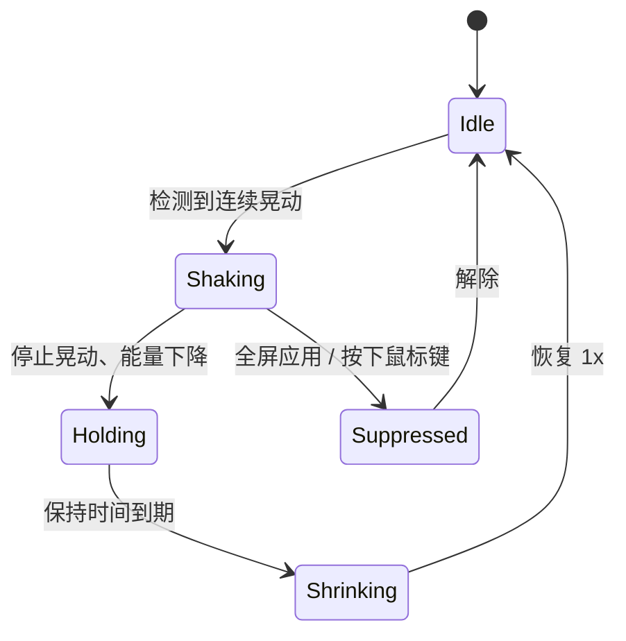
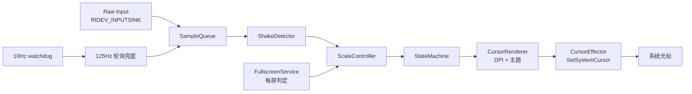

# CursorBeacon

[English](README.md)

**CursorBeacon** 是一个轻量的 Windows 工具：快速来回晃动鼠标时，把**真实的系统光标**逐步放大；停止晃动后自动缩回。它面向 4K/8K 显示器和多屏环境，全屏应用所在屏不会启用。


> **当前版本：0.1.0 预览版。** 核心服务已可用并通过测试；托盘图标、设置界面和开机自启在后续里程碑中。

---

## 解决什么问题

大屏、高 DPI 或多屏环境下，鼠标指针很容易“消失”。CursorBeacon 用晃动鼠标触发临时放大，直接替换系统光标——没有 overlay 窗口、没有全局输入 Hook、不需要管理员权限。停止晃动后恢复原样。

灵感来自 macOS 的 *Shake mouse pointer to locate*，并针对 Windows 多屏/DPI 做了额外处理：

- 每屏 DPI（100%–300%）
- 每屏全屏抑制
- Raw Input 采样 + 低功耗轮询兜底
- 崩溃/退出后安全恢复光标

## 行为



一次有效的“晃动”默认需要同时满足：

- 600ms 内至少 3 次方向反转
- 峰值速度 ≥ 800 DIP/s
- 晃动幅度 ≥ 80 DIP
- 路径长度 ≥ 250 DIP
- 净位移 / 路径长度 ≤ 0.50
- 净位移 / 晃动幅度 ≤ 0.35
- 能量持续 250ms 才激活放大

后三条是关键：来回晃动会回到起点附近，普通移动/锯齿导航会持续前进，因此不会误触发。恢复后还有 600ms 冷却，避免在阈值边界反复放大缩小。

## 功能

- **渐进放大**：1.25x、1.5x、2x、3x、4x……最高 8x（默认最大 4x）
- **自动缩回**：停止后保持 800ms，再平滑回到 1x
- **点击立即缩回**：按下任意鼠标键
- **每屏 DPI**：按光标所在显示器的 DPI 计算目标尺寸
- **每屏全屏抑制**：A 屏全屏不影响 B 屏
- **真实系统光标**：`SetSystemCursor` 替换，保留形状和热区
- **低开销**：Raw Input 事件驱动；10Hz watchdog；仅在需要时 125Hz 轮询
- **崩溃恢复**：脏标记 + `--restore` + 退出/异常处理
- **无管理员、无网络、无遥测**

## 系统要求

- Windows 10 1809+ / Windows 11，x64
- 无 .NET / VC++ 运行时依赖（静态链接）
- 普通用户权限，**不需要管理员**

## 安装

1. 从 [最新版本](../../releases/latest) 下载 `CursorBeacon-0.1.0-win64.zip`。
2. 解压到任意目录，例如 `%LOCALAPPDATA%\Programs\CursorBeacon`。
3. 运行：

```powershell
.\start-service.ps1
```

4. 快速来回晃鼠标，光标会逐步放大；停住后自动缩回。

常用脚本：

```powershell
.\status.ps1          # 查看进程、内存和最近日志
.\stop-service.ps1    # 优雅停止并恢复光标
```

> **SmartScreen / 杀软提示：** exe 未签名。如果 Windows 提示风险，请先核对 `CHECKSUMS.txt` 中的 SHA256；也可以从源码自行构建。

手动/便携启动：

```powershell
.\CursorBeacon.exe --run
```

## 使用说明

### 晃动

快速来回晃动鼠标，频率约 3–5Hz，行程至少 300px。光标会分级放大。停止移动后保持 800ms，然后逐级缩回。

普通移动——跨屏、在窗口之间移动、锯齿状导航——会被过滤。按住鼠标键拖拽/选择时不会触发。

### 点击立即恢复

按下任意鼠标键立即恢复，适合放大后的光标挡住操作时使用。

### 全屏应用

根据前台窗口几何和 Windows 全屏状态逐屏判断。A 屏全屏时，在 A 屏晃动不触发；B 屏仍可用。放大中把光标移入全屏屏，约 100ms 内恢复。

### 多屏与高 DPI

放大尺寸按光标所在显示器的正常光标大小计算（`GetDpiForMonitor` + `GetSystemMetricsForDpi`），并尊重 Windows 辅助功能光标大小。144 DPI 屏 4x 为 192px；100% 屏 4x 为 128px。

### 命令行参考

```text
CursorBeacon.exe --run [--duration N] [--verbose]
CursorBeacon.exe --stats [seconds]
CursorBeacon.exe --test-scale [N]
CursorBeacon.exe --dump-monitors
CursorBeacon.exe --dump-cursors
CursorBeacon.exe --restore
CursorBeacon.exe --stop
CursorBeacon.exe --self-test
CursorBeacon.exe --version
```

| 选项 | 说明 |
|---|---|
| `--run` | 启动控制器（控制台服务）；`--duration N` 运行 N 秒后退出 |
| `--stats [s]` | 只采样并打印统计，不修改光标，默认 5 秒 |
| `--test-scale [N]` | 实际放大 N 倍 2 秒后恢复，用于验证权限/主题 |
| `--dump-monitors` | 打印显示器、工作区、DPI 和全屏判定 |
| `--dump-cursors` | 打印用户光标主题路径与基准尺寸 |
| `--restore` | 立即恢复系统光标 |
| `--stop` | 请求运行中的服务退出并恢复 |
| `--self-test` | 运行内置逻辑自测 |
| `--config PATH` | 指定配置文件 |
| `--scale N` | 覆盖最大倍率 1–8 |
| `--sensitivity N` | 覆盖灵敏度 1–10 |
| `--hold-ms N` | 覆盖保持时间 0–5000ms |
| `--verbose` | 调试日志 |

## 配置

路径：`%APPDATA%\CursorBeacon\config.ini`

```ini
enabled=true
max_scale=4
sensitivity=5
hold_ms=800
grow_tau_ms=60
shrink_tau_ms=180
update_hz=30
sampling_mode=auto
cursor_set=Arrow,IBeam,Hand,Crosshair
pause_on_fullscreen=true
pause_on_click=true
```

| 键 | 默认 | 说明 |
|---|---:|---|
| `max_scale` | `4` | 最大倍率 1–8 |
| `sensitivity` | `5` | 1–10；默认 3 次反转，8–10 为 2 次（更灵敏），1–2 为 4 次（更保守） |
| `hold_ms` | `800` | 停止晃动后的保持时间 |
| `grow_tau_ms` | `60` | 放大平滑时间常数 |
| `shrink_tau_ms` | `180` | 缩小平滑时间常数 |
| `update_hz` | `30` | 光标帧最大更新频率 |
| `sampling_mode` | `auto` | 保留字段；自动选择 Raw Input/轮询 |
| `cursor_set` | `Arrow,IBeam,Hand,Crosshair` | 放大的光标类型；`all` 表示全部 |
| `pause_on_fullscreen` | `true` | 全屏屏禁用 |
| `pause_on_click` | `true` | 按下鼠标键立即恢复 |

修改后需要重启服务：

```powershell
.\stop-service.ps1
.\start-service.ps1
```

### 调参建议

- **太容易触发**：把 `sensitivity` 改成 `1` 或 `2`，重启。
- **很难触发**：改成 `8`–`10`，用 3–5Hz、300px 以上的刻意来回晃动。
- **光标太大/太小**：调整 `max_scale`（2–8）。
- **某个应用不要放大**：保持 `pause_on_fullscreen=true`；全屏应用已自动排除。

## 日志

- `%LOCALAPPDATA%\CursorBeacon\service.err.log`
- `%LOCALAPPDATA%\CursorBeacon\service.out.log`

`start-service.ps1` 会在启动前清空日志。每次 scale 变化和恢复都带毫秒时间戳；`--run --verbose` 每 2 秒打印检测器统计。

## 工作原理



- **采样**：Raw Input 为主；10Hz watchdog 检测没有 Raw Input 的移动（精密触控板/RDP），临时切到 125Hz 轮询。同一时刻只有一个生产者。
- **检测**：方向反转、速度、幅度、路径长度、净位移比例；250ms 激活 + 600ms 冷却。
- **缩放**：能量映射到目标倍率，平滑控制器以最多 30Hz 输出量化帧。
- **DPI**：`GetDpiForMonitor` + `GetSystemMetricsForDpi`；放大中跨屏会重新渲染。
- **光标替换**：读取用户当前 `.cur` 主题，按目标尺寸加载；`SetSystemCursor` 替换系统光标，无 overlay。
- **恢复**：`SystemParametersInfo(SPI_SETCURSORS)` 重新加载用户方案；脏标记用于崩溃后下次启动恢复。

## 性能

实测环境：3 台显示器，均为 144 DPI（2880×1800 + 2560×1440 ×2）。

| 指标 | 结果 |
|---|---|
| Release 二进制 | 约 940KB，无运行时 DLL |
| 空闲 working set | 约 10.8MB |
| 空闲 CPU | 约 0.05%（4 核） |
| 4x 光标 | 144 DPI 下 192px |
| 测试 | 26 个 doctest + 13 项内置自测 |

## 从源码构建

本地使用免安装 LLVM-MinGW；CMake 也支持 MSVC。

```bash
source tools/env.sh
cmake -S . -B build -G Ninja \
  -DCMAKE_CXX_COMPILER="$CXX" \
  -DCMAKE_RC_COMPILER="$(cygpath -m "$LLVM_MINGW")/bin/windres.exe" \
  -DCMAKE_BUILD_TYPE=Release
cmake --build build
ctest --test-dir build --output-on-failure
```

或：

```bash
bash tools/build.sh
```

如果应用程序控制策略拦截独立的测试 exe：

```powershell
.\build\CursorBeacon.exe --self-test
```

`tools/build.sh` 检测到这种情况会自动回退。

## 常见问题

| 问题 | 排查 |
|---|---|
| 晃动没反应 | 用 3–5Hz、300px 以上的刻意来回晃；把 `sensitivity` 调到 8–10；用 `--dump-monitors` 确认光标所在屏不是全屏 |
| 太容易触发 | 把 `sensitivity` 调到 1–2，重启服务 |
| 光标卡在大号 | `CursorBeacon.exe --restore`；如果服务在运行，先 `--stop` |
| 服务启动失败 | 看 `%LOCALAPPDATA%\CursorBeacon\service.err.log`；SmartScreen 可能拦截未签名 exe |
| 游戏里无效 | 全屏游戏按设计排除；窗口化游戏可能使用自绘光标 |
| 多屏异常 | 运行 `CursorBeacon.exe --dump-monitors`，把输出附到 issue |

## 已知限制

- 还没有托盘图标、设置窗口和开机自启；目前用 PowerShell 脚本管理。
- 全屏检测目前只看前台窗口 + 几何；后台全屏/z 序扫描未实现。
- App 自绘光标不受 `SetSystemCursor` 影响。
- `.ani` 动画光标在放大期间可能显示首帧。
- 光标主题变更后需要重启服务。
- 混合 100%/150%/200% DPI 仍需更广泛测试；当前机器为 3×144 DPI。
- exe 未签名，暂无代码签名。
- 同会话进程可以触发停止事件（`Local\CursorBeacon.StopRequest`），属于同用户级 DoS。

## 路线图

1. 托盘图标、设置界面、开机自启。
2. 前台/显示器/会话事件钩子，z 序全屏扫描。
3. 安装器、代码签名、CI 矩阵、长时间浸泡测试。

## 安全与隐私

- 无网络请求、无遥测、无自动更新。
- 不注入进程、不挂全局输入 Hook、不读取其他进程内存。
- 只读 `HKCU\Control Panel\Cursors` 和用户当前 `.cur`；只写 `%APPDATA%\CursorBeacon`、`%LOCALAPPDATA%\CursorBeacon`。
- 不需要管理员权限。
- 完整审查见 [docs/REVIEW.md](docs/REVIEW.md)。

## 项目结构

```text
src/
  core/        检测器、倍率控制、状态机、全屏规则
  platform/    Raw Input、显示器、光标主题/渲染/替换、全屏
  app/         控制器、自测
  config/      INI 配置
  lifecycle/   单实例、崩溃保护、停止事件
  util/        日志、QPC 时间
tests/         doctest 单元测试
tools/         环境脚本、构建脚本、工具链检查
resources/     manifest + RC
docs/          审查报告
PLAN.md        调研、设计与实施计划
```

## 发行包校验

`CursorBeacon-0.1.0-win64.zip`：

```text
SHA256  0BE3E2007DC15042B02D607A1D164E7F668ADA759E3BB8F7AA944B1CEC18C306
```

`CursorBeacon.exe`：

```text
SHA256  C40E25FCEE6C802E20C46353F9ABAB00E9106201994F0B38EE93A1EF69FB8723
```

变更记录见 [CHANGELOG.md](CHANGELOG.md)。

## 参与贡献

欢迎 issue / PR。提交问题时请附：

- Windows 版本、显示器布局、缩放比例
- 问题出现在全屏还是窗口化应用
- `--dump-monitors` 输出
- 相关日志（`%LOCALAPPDATA%\CursorBeacon\service.err.log`）

## 许可证

MIT，见 [LICENSE](LICENSE)。
